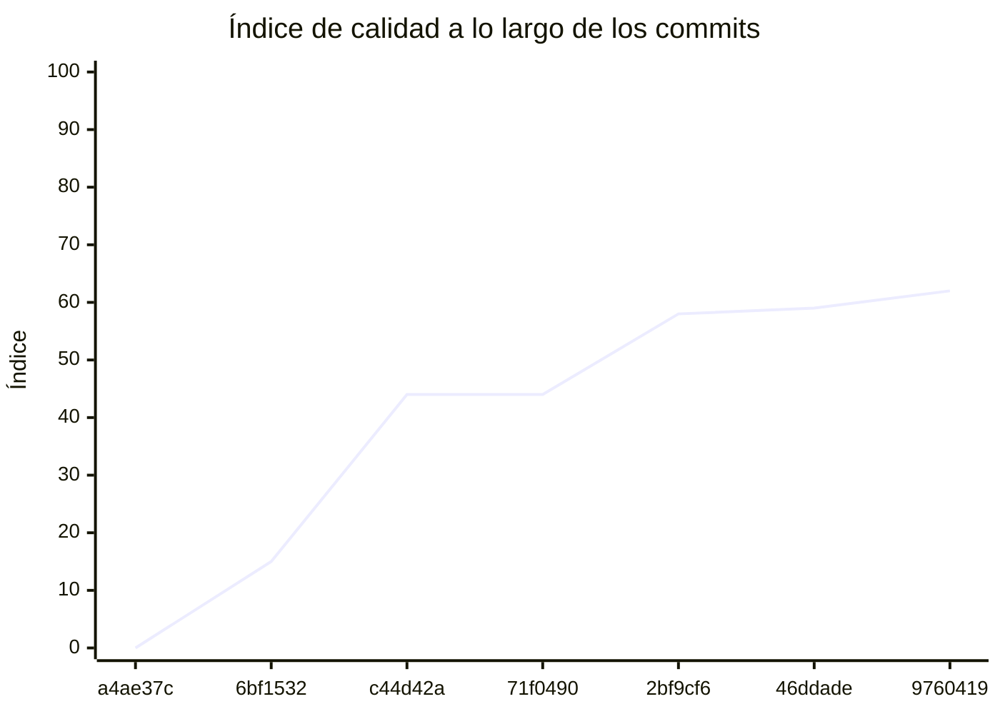

<!-- evaluacion:inicio -->
# Evaluación — Tejada-ProgramacionII/catalogo-sincronizacion-service

> Documento **generado automáticamente** por la cátedra de Programación II (UM): RepoSense + análisis de calidad de **7 dimensiones**. **No editar a mano**: se regenera en cada evaluación.
> Rama evaluada: `main`. Análisis **heurístico** (regex + métricas) + build: es una criba para orientar la revisión, **no una nota**. La **documentación** del repositorio no se evalúa.
> Generado: 2026-11-12.

## 1. Veredicto

| Aspecto | Resultado |
|---|---|
| Índice de calidad | **73/100** |
| Tipo de repositorio | `backend` |
| Build (`mvnw verify` / `gradlew check`) | OK |
| Código (LOC) | 6,113 |
| Archivos de código | 153 |
| Clases | 156 |
| Código dentro de clases (%POO) | 70% |
| Funciones fuera de clases | 0 |
| Duplicación (puerta) | 2.2% |
| Duplicación lógica | 2.5% |
| Duplicación de boilerplate | 23.2% |
| Cobertura | 100% |
| Tope duro aplicado a D1 | `POO_BAJO` → D1 ≤ 60 |

> Este informe **describe** lo que el análisis midió con los criterios ya establecidos de la materia. No es una nota.

## 2. Semáforo de aprobación

Criterios de la cátedra (`CRITERIOS-CALIDAD.md`): **Aprobar** se juega con el perfil `estandar`; **destacar**, con el `exigente` (meta de excelencia).

| Semáforo | Resultado |
|---|---|
| Aprobar (`estandar`) | **no cumple** — 7/11 |
| Destacar (`exigente`) | **no cumple** — 5/11 |

**Para aprobar, falta cumplir:** SOLID

**Para destacar, falta cumplir:** SOLID; POO; Duplicación

## 3. Autoría (RepoSense)

| Autor | Commits | Código (LOC) | Tests (LOC) | Docs (LOC) | Días activos | % del código |
|---|---:|---:|---:|---:|---:|---:|
| Joaquin Tejada Pareja | 1 | 0 | 0 | 2 | 14 | 0% |

> _El LOC de autoría lo calcula RepoSense sobre el historial y puede diferir del LOC de código del análisis (que mira el estado de `main`)._

## 4. Dimensiones evaluadas

Cada dimensión indica **qué mide**, **por qué importa** y **tu resultado**. Cuando el puntaje queda por debajo de la referencia, se agregan preguntas para **investigar la causa** (no hay recetas).

| Dimensión | Peso | Puntaje |
|:--|--:|--:|
| **D1** Diseño OO, SOLID y patrones (20%) | 20% | 3 |
| **D2** Arquitectura hexagonal — backend (15%) | 15% | 100 |
| **D3** Frontend KMP: MVVM y buenas prácticas (10%) | 10% | N/A |
| **D4** Integración y contrato (10%) | 10% | 50 |
| **D5** Seguridad y robustez (10%) | 10% | 100 |
| **D6** Pruebas y cobertura (20%) | 20% | 100 |
| **D7** Proceso y entrega (15%) | 15% | 100 |

### D1. Diseño OO, SOLID y patrones (20%)

- **Qué mide:** Métricas orientadas a objetos (clases, métodos, campos, cohesión, acoplamiento, herencia) y proxies de SOLID, más patrones de diseño.
- **Por qué importa:** El eje de la materia es el buen uso de la POO y su arquitectura: un diseño con clases claras y poco acopladas es más fácil de entender, probar y cambiar.
- **Tu resultado:** **3/100**
- **Para investigar la causa:**
    - ¿Se pensó el modelo de clases antes de codificar o se agrupó después?
    - ¿Qué clases concentran muchas responsabilidades a la vez?
    - ¿Los colaboradores llegan como parámetros o se crean por dentro?

### D2. Arquitectura hexagonal — backend (15%)

- **Qué mide:** Separación en capas (dominio, puertos de entrada/salida, adaptadores) y dirección de las dependencias del backend.
- **Por qué importa:** Aislar el dominio de la infraestructura permite cambiar la base de datos, el framework o el transporte sin tocar las reglas de negocio.
- **Tu resultado:** **100/100**

### D4. Integración y contrato (10%)

- **Qué mide:** Cumplimiento del contrato de integración de la cátedra (formato de errores, paginación, autenticación, endpoints esperados).
- **Por qué importa:** Los servicios deben poder integrarse entre sí y con la app sin sorpresas; el contrato es lo que hacen cumplir las pruebas de integración.
- **Tu resultado:** **50/100**
- **Para investigar la causa:**
    - ¿Qué endpoints difieren del contrato acordado?
    - ¿Los errores se devuelven con un formato uniforme?
    - ¿La autenticación es consistente entre servicios?

### D5. Seguridad y robustez (10%)

- **Qué mide:** Credenciales embebidas, consultas SQL por concatenación, y presencia de config de entorno; aislamiento de secretos.
- **Por qué importa:** Un secreto en el repositorio o una consulta construida por concatenación son riesgos concretos, no hipotéticos.
- **Tu resultado:** **100/100**

### D6. Pruebas y cobertura (20%)

- **Qué mide:** Cantidad y resultado de pruebas y cobertura de línea (JaCoCo/Kover, Surefire/Failsafe) cuando hay build.
- **Por qué importa:** Las pruebas son la red de seguridad para refactorizar e integrar; la cobertura acota las zonas sin verificar.
- **Tu resultado:** **100/100**

### D7. Proceso y entrega (15%)

- **Qué mide:** Artefactos verificables de proceso/entrega: `compose`, `.env.example`, CI (`.github/workflows/`), `CODEOWNERS` y wrapper de build (`mvnw`/`gradlew`). **No** puntúa documentación.
- **Por qué importa:** Un proyecto que compila, se levanta y se valida solo es más fácil de revisar y de integrar en equipo.
- **Tu resultado:** **100/100**

## 5. Señales detectadas

El análisis encontró las siguientes señales (archivo, sin número de línea a propósito):

**DIP/concretos** (58)
- clase 'JpaProfesionalRepository' muy acoplada (CBO=17) — `src/main/java/ar/edu/um/programacion2/catalogo/profesional/infrastructure/persistence/repository/JpaProfesionalRepository.java`
- clase 'JpaProfesionalRepositoryAdapter' muy acoplada (CBO=13) — `src/main/java/ar/edu/um/programacion2/catalogo/profesional/infrastructure/persistence/adapter/JpaProfesionalRepositoryAdapter.java`
- clase 'ProfesionalController' muy acoplada (CBO=16) — `src/main/java/ar/edu/um/programacion2/catalogo/profesional/infrastructure/web/controller/ProfesionalController.java`
- clase 'ProfesionalDtoMapper' muy acoplada (CBO=10) — `src/main/java/ar/edu/um/programacion2/catalogo/profesional/infrastructure/web/mapper/ProfesionalDtoMapper.java`
- clase 'ConsultarProfesionalUseCaseImpl' muy acoplada (CBO=9) — `src/main/java/ar/edu/um/programacion2/catalogo/profesional/application/usecases/ConsultarProfesionalUseCaseImpl.java`
- clase 'BuscarProfesionalesUseCaseImpl' muy acoplada (CBO=10) — `src/main/java/ar/edu/um/programacion2/catalogo/profesional/application/usecases/BuscarProfesionalesUseCaseImpl.java`
- clase 'CatalogUpdatedConsumer' muy acoplada (CBO=10) — `src/main/java/ar/edu/um/programacion2/catalogo/sincronizacion/infrastructure/messaging/consumer/CatalogUpdatedConsumer.java`
- clase 'SnapshotCatalogoClientMapper' muy acoplada (CBO=8) — `src/main/java/ar/edu/um/programacion2/catalogo/sincronizacion/infrastructure/client/mapper/SnapshotCatalogoClientMapper.java`
- clase 'HttpCatalogoCatedraClientAdapter' muy acoplada (CBO=13) — `src/main/java/ar/edu/um/programacion2/catalogo/sincronizacion/infrastructure/client/adapter/HttpCatalogoCatedraClientAdapter.java`
- clase 'HttpCatalogoCatedraClientAdapter' instancia 4 concretos (CBO=13) — `src/main/java/ar/edu/um/programacion2/catalogo/sincronizacion/infrastructure/client/adapter/HttpCatalogoCatedraClientAdapter.java`
- clase 'RedisCatalogoPublicadoClientAdapter' muy acoplada (CBO=29) — `src/main/java/ar/edu/um/programacion2/catalogo/sincronizacion/infrastructure/cache/adapter/RedisCatalogoPublicadoClientAdapter.java`
- clase 'RedisCatalogoPublicadoClientAdapter' instancia 3 concretos (CBO=29) — `src/main/java/ar/edu/um/programacion2/catalogo/sincronizacion/infrastructure/cache/adapter/RedisCatalogoPublicadoClientAdapter.java`
- clase 'SincronizacionService' muy acoplada (CBO=49) — `src/main/java/ar/edu/um/programacion2/catalogo/sincronizacion/application/service/SincronizacionService.java`
- clase 'ConsultarEstadoSincronizacionUseCaseImpl' muy acoplada (CBO=15) — `src/main/java/ar/edu/um/programacion2/catalogo/sincronizacion/application/usecases/ConsultarEstadoSincronizacionUseCaseImpl.java`
- clase 'SincronizarCatalogoIncrementalUseCaseImpl' muy acoplada (CBO=19) — `src/main/java/ar/edu/um/programacion2/catalogo/sincronizacion/application/usecases/SincronizarCatalogoIncrementalUseCaseImpl.java`
- clase 'SincronizarCatalogoIncrementalUseCaseImpl' instancia 3 concretos (CBO=19) — `src/main/java/ar/edu/um/programacion2/catalogo/sincronizacion/application/usecases/SincronizarCatalogoIncrementalUseCaseImpl.java`
- clase 'SincronizarCatalogoCompletoUseCaseImpl' muy acoplada (CBO=9) — `src/main/java/ar/edu/um/programacion2/catalogo/sincronizacion/application/usecases/SincronizarCatalogoCompletoUseCaseImpl.java`
- clase 'JwtConfig' muy acoplada (CBO=9) — `src/main/java/ar/edu/um/programacion2/catalogo/config/JwtConfig.java`
- clase 'JwtConfig' instancia 3 concretos (CBO=9) — `src/main/java/ar/edu/um/programacion2/catalogo/config/JwtConfig.java`
- clase 'CatedraRedisConfig' muy acoplada (CBO=9) — `src/main/java/ar/edu/um/programacion2/catalogo/config/CatedraRedisConfig.java`
- clase 'CatedraRedisConfig' instancia 3 concretos (CBO=9) — `src/main/java/ar/edu/um/programacion2/catalogo/config/CatedraRedisConfig.java`
- clase 'ProfesionalMapperTest' muy acoplada (CBO=8) — `src/test/java/ar/edu/um/programacion2/catalogo/profesional/infrastructure/persistence/mapper/ProfesionalMapperTest.java`
- clase 'JpaProfesionalRepositoryAdapterTest' muy acoplada (CBO=9) — `src/test/java/ar/edu/um/programacion2/catalogo/profesional/infrastructure/persistence/adapter/JpaProfesionalRepositoryAdapterTest.java`
- clase 'JpaProfesionalRepositoryAdapterBusquedaTest' muy acoplada (CBO=25) — `src/test/java/ar/edu/um/programacion2/catalogo/profesional/infrastructure/persistence/adapter/JpaProfesionalRepositoryAdapterBusquedaTest.java`
- clase 'ProfesionalControllerTest' muy acoplada (CBO=22) — `src/test/java/ar/edu/um/programacion2/catalogo/profesional/infrastructure/web/controller/ProfesionalControllerTest.java`
- clase 'ProfesionalControllerTest' instancia 6 concretos (CBO=22) — `src/test/java/ar/edu/um/programacion2/catalogo/profesional/infrastructure/web/controller/ProfesionalControllerTest.java`
- clase 'ProfesionalDtoMapperTest' muy acoplada (CBO=16) — `src/test/java/ar/edu/um/programacion2/catalogo/profesional/infrastructure/web/mapper/ProfesionalDtoMapperTest.java`
- clase 'ProfesionalServiceTest' muy acoplada (CBO=9) — `src/test/java/ar/edu/um/programacion2/catalogo/profesional/application/service/ProfesionalServiceTest.java`
- clase 'ConsultarProfesionalUseCaseImplTest' muy acoplada (CBO=15) — `src/test/java/ar/edu/um/programacion2/catalogo/profesional/application/usecases/ConsultarProfesionalUseCaseImplTest.java`
- clase 'BuscarProfesionalesUseCaseImplTest' muy acoplada (CBO=12) — `src/test/java/ar/edu/um/programacion2/catalogo/profesional/application/usecases/BuscarProfesionalesUseCaseImplTest.java`
- clase 'IntentoSincronizacionMapperTest' muy acoplada (CBO=12) — `src/test/java/ar/edu/um/programacion2/catalogo/sincronizacion/infrastructure/persistence/mapper/IntentoSincronizacionMapperTest.java`
- clase 'JpaVersionAplicadaRepositoryAdapterTest' muy acoplada (CBO=8) — `src/test/java/ar/edu/um/programacion2/catalogo/sincronizacion/infrastructure/persistence/adapter/JpaVersionAplicadaRepositoryAdapterTest.java`
- clase 'JpaIntentoSincronizacionRepositoryAdapterTest' muy acoplada (CBO=9) — `src/test/java/ar/edu/um/programacion2/catalogo/sincronizacion/infrastructure/persistence/adapter/JpaIntentoSincronizacionRepositoryAdapterTest.java`
- clase 'CatalogUpdatedConsumerTest' muy acoplada (CBO=12) — `src/test/java/ar/edu/um/programacion2/catalogo/sincronizacion/infrastructure/messaging/consumer/CatalogUpdatedConsumerTest.java`
- clase 'CatalogUpdatedConsumerTest' instancia 3 concretos (CBO=12) — `src/test/java/ar/edu/um/programacion2/catalogo/sincronizacion/infrastructure/messaging/consumer/CatalogUpdatedConsumerTest.java`
- clase 'SnapshotCatalogoClientMapperTest' muy acoplada (CBO=14) — `src/test/java/ar/edu/um/programacion2/catalogo/sincronizacion/infrastructure/client/mapper/SnapshotCatalogoClientMapperTest.java`
- clase 'HttpCatalogoCatedraClientAdapterTest' muy acoplada (CBO=34) — `src/test/java/ar/edu/um/programacion2/catalogo/sincronizacion/infrastructure/client/adapter/HttpCatalogoCatedraClientAdapterTest.java`
- clase 'HttpCatalogoCatedraClientAdapterTest' instancia 8 concretos (CBO=34) — `src/test/java/ar/edu/um/programacion2/catalogo/sincronizacion/infrastructure/client/adapter/HttpCatalogoCatedraClientAdapterTest.java`
- clase 'RedisCatalogoPublicadoClientAdapterTest' muy acoplada (CBO=44) — `src/test/java/ar/edu/um/programacion2/catalogo/sincronizacion/infrastructure/cache/adapter/RedisCatalogoPublicadoClientAdapterTest.java`
- clase 'RedisCatalogoPublicadoClientAdapterTest' instancia 11 concretos (CBO=44) — `src/test/java/ar/edu/um/programacion2/catalogo/sincronizacion/infrastructure/cache/adapter/RedisCatalogoPublicadoClientAdapterTest.java`
- clase 'RedisCatalogoPublicadoClientAdapterSinRedisTest' muy acoplada (CBO=13) — `src/test/java/ar/edu/um/programacion2/catalogo/sincronizacion/infrastructure/cache/adapter/RedisCatalogoPublicadoClientAdapterSinRedisTest.java`
- clase 'RedisCatalogoPublicadoClientAdapterSinRedisTest' instancia 6 concretos (CBO=13) — `src/test/java/ar/edu/um/programacion2/catalogo/sincronizacion/infrastructure/cache/adapter/RedisCatalogoPublicadoClientAdapterSinRedisTest.java`
- clase 'SincronizacionControllerTest' muy acoplada (CBO=19) — `src/test/java/ar/edu/um/programacion2/catalogo/sincronizacion/infrastructure/web/controller/SincronizacionControllerTest.java`
- clase 'SincronizacionDtoMapperTest' muy acoplada (CBO=14) — `src/test/java/ar/edu/um/programacion2/catalogo/sincronizacion/infrastructure/web/mapper/SincronizacionDtoMapperTest.java`
- clase 'SincronizacionServiceTest' muy acoplada (CBO=50) — `src/test/java/ar/edu/um/programacion2/catalogo/sincronizacion/application/service/SincronizacionServiceTest.java`
- clase 'SincronizacionServiceTest' instancia 15 concretos (CBO=50) — `src/test/java/ar/edu/um/programacion2/catalogo/sincronizacion/application/service/SincronizacionServiceTest.java`
- clase 'SincronizarCatalogoCompletoIntegrationTest' muy acoplada (CBO=24) — `src/test/java/ar/edu/um/programacion2/catalogo/sincronizacion/application/usecases/SincronizarCatalogoCompletoIntegrationTest.java`
- clase 'SincronizarCatalogoIncrementalIntegrationTest' muy acoplada (CBO=29) — `src/test/java/ar/edu/um/programacion2/catalogo/sincronizacion/application/usecases/SincronizarCatalogoIncrementalIntegrationTest.java`
- clase 'ConsultarEstadoSincronizacionUseCaseImplTest' muy acoplada (CBO=17) — `src/test/java/ar/edu/um/programacion2/catalogo/sincronizacion/application/usecases/ConsultarEstadoSincronizacionUseCaseImplTest.java`
- clase 'SincronizarCatalogoCompletoUseCaseImplTest' muy acoplada (CBO=14) — `src/test/java/ar/edu/um/programacion2/catalogo/sincronizacion/application/usecases/SincronizarCatalogoCompletoUseCaseImplTest.java`
- clase 'SincronizarCatalogoIncrementalUseCaseImplTest' muy acoplada (CBO=21) — `src/test/java/ar/edu/um/programacion2/catalogo/sincronizacion/application/usecases/SincronizarCatalogoIncrementalUseCaseImplTest.java`
- clase 'CatedraClientConfigTest' muy acoplada (CBO=10) — `src/test/java/ar/edu/um/programacion2/catalogo/config/CatedraClientConfigTest.java`
- clase 'CatedraClientConfigTest' instancia 3 concretos (CBO=10) — `src/test/java/ar/edu/um/programacion2/catalogo/config/CatedraClientConfigTest.java`
- clase 'SecurityConfigTest' muy acoplada (CBO=24) — `src/test/java/ar/edu/um/programacion2/catalogo/config/SecurityConfigTest.java`
- clase 'HorarioSemanalMapperTest' muy acoplada (CBO=8) — `src/test/java/ar/edu/um/programacion2/catalogo/horario/infrastructure/persistence/mapper/HorarioSemanalMapperTest.java`
- clase 'JpaHorarioSemanalRepositoryAdapterHabilitadosTest' muy acoplada (CBO=16) — `src/test/java/ar/edu/um/programacion2/catalogo/horario/infrastructure/persistence/adapter/JpaHorarioSemanalRepositoryAdapterHabilitadosTest.java`
- clase 'JpaHorarioSemanalRepositoryAdapterTest' muy acoplada (CBO=10) — `src/test/java/ar/edu/um/programacion2/catalogo/horario/infrastructure/persistence/adapter/JpaHorarioSemanalRepositoryAdapterTest.java`
- clase 'JpaCategoriaRepositoryAdapterTest' muy acoplada (CBO=9) — `src/test/java/ar/edu/um/programacion2/catalogo/categoria/infrastructure/persistence/adapter/JpaCategoriaRepositoryAdapterTest.java`

**SRP/responsabilidad** (61)
- clase 'JpaProfesionalRepositoryAdapter' con baja cohesión (48%) — `src/main/java/ar/edu/um/programacion2/catalogo/profesional/infrastructure/persistence/adapter/JpaProfesionalRepositoryAdapter.java`
- clase 'ProfesionalEntity' sin métodos (7 campos): solo datos — `src/main/java/ar/edu/um/programacion2/catalogo/profesional/infrastructure/persistence/entity/ProfesionalEntity.java`
- clase 'ProfesionalResponse' sin métodos (5 campos): solo datos — `src/main/java/ar/edu/um/programacion2/catalogo/profesional/infrastructure/web/dto/ProfesionalResponse.java`
- clase 'AgendaProfesionalResponse' sin métodos (7 campos): solo datos — `src/main/java/ar/edu/um/programacion2/catalogo/profesional/infrastructure/web/dto/AgendaProfesionalResponse.java`
- clase 'PaginaResponse' sin métodos (5 campos): solo datos — `src/main/java/ar/edu/um/programacion2/catalogo/profesional/infrastructure/web/dto/PaginaResponse.java`
- clase 'HorarioSemanalResponse' sin métodos (4 campos): solo datos — `src/main/java/ar/edu/um/programacion2/catalogo/profesional/infrastructure/web/dto/HorarioSemanalResponse.java`
- clase 'Pagina' sin métodos (5 campos): solo datos — `src/main/java/ar/edu/um/programacion2/catalogo/profesional/domain/model/Pagina.java`
- clase 'Profesional' sin métodos (7 campos): solo datos — `src/main/java/ar/edu/um/programacion2/catalogo/profesional/domain/model/Profesional.java`
- clase 'AgendaProfesional' sin métodos (3 campos): solo datos — `src/main/java/ar/edu/um/programacion2/catalogo/profesional/domain/model/AgendaProfesional.java`
- clase 'AvisoCatalogoEntity' sin métodos (3 campos): solo datos — `src/main/java/ar/edu/um/programacion2/catalogo/sincronizacion/infrastructure/persistence/entity/AvisoCatalogoEntity.java`
- clase 'VersionAplicadaEntity' sin métodos (4 campos): solo datos — `src/main/java/ar/edu/um/programacion2/catalogo/sincronizacion/infrastructure/persistence/entity/VersionAplicadaEntity.java`
- clase 'UltimaVerificacionEntity' sin métodos (3 campos): solo datos — `src/main/java/ar/edu/um/programacion2/catalogo/sincronizacion/infrastructure/persistence/entity/UltimaVerificacionEntity.java`
- clase 'IntentoSincronizacionEntity' grande (LOC=12, métodos=0, campos=8) — `src/main/java/ar/edu/um/programacion2/catalogo/sincronizacion/infrastructure/persistence/entity/IntentoSincronizacionEntity.java`
- clase 'IntentoSincronizacionEntity' sin métodos (8 campos): solo datos — `src/main/java/ar/edu/um/programacion2/catalogo/sincronizacion/infrastructure/persistence/entity/IntentoSincronizacionEntity.java`
- clase 'CatalogUpdatedEvent' sin métodos (3 campos): solo datos — `src/main/java/ar/edu/um/programacion2/catalogo/sincronizacion/infrastructure/messaging/dto/CatalogUpdatedEvent.java`
- clase 'SnapshotCatalogoResponse' sin métodos (5 campos): solo datos — `src/main/java/ar/edu/um/programacion2/catalogo/sincronizacion/infrastructure/client/dto/SnapshotCatalogoResponse.java`
- clase 'ProfesionalCatedraResponse' sin métodos (7 campos): solo datos — `src/main/java/ar/edu/um/programacion2/catalogo/sincronizacion/infrastructure/client/dto/ProfesionalCatedraResponse.java`
- clase 'HorarioSemanalCatedraResponse' grande (LOC=11, métodos=0, campos=9) — `src/main/java/ar/edu/um/programacion2/catalogo/sincronizacion/infrastructure/client/dto/HorarioSemanalCatedraResponse.java`
- clase 'HorarioSemanalCatedraResponse' sin métodos (9 campos): solo datos — `src/main/java/ar/edu/um/programacion2/catalogo/sincronizacion/infrastructure/client/dto/HorarioSemanalCatedraResponse.java`
- clase 'CategoriaCatedraResponse' sin métodos (6 campos): solo datos — `src/main/java/ar/edu/um/programacion2/catalogo/sincronizacion/infrastructure/client/dto/CategoriaCatedraResponse.java`
- clase 'RedisCatalogoPublicadoClientAdapter' grande (LOC=77, métodos=11, campos=11) — `src/main/java/ar/edu/um/programacion2/catalogo/sincronizacion/infrastructure/cache/adapter/RedisCatalogoPublicadoClientAdapter.java`
- clase 'RedisCatalogoPublicadoClientAdapter' con baja cohesión (22%) — `src/main/java/ar/edu/um/programacion2/catalogo/sincronizacion/infrastructure/cache/adapter/RedisCatalogoPublicadoClientAdapter.java`
- método 'RedisCatalogoPublicadoClientAdapter.leerHash' con 5 parámetros — `src/main/java/ar/edu/um/programacion2/catalogo/sincronizacion/infrastructure/cache/adapter/RedisCatalogoPublicadoClientAdapter.java`
- clase 'CambiosCatedraResponse' sin métodos (3 campos): solo datos — `src/main/java/ar/edu/um/programacion2/catalogo/sincronizacion/infrastructure/cache/dto/CambiosCatedraResponse.java`
- clase 'EstadoSincronizacionResponse' sin métodos (5 campos): solo datos — `src/main/java/ar/edu/um/programacion2/catalogo/sincronizacion/infrastructure/web/dto/EstadoSincronizacionResponse.java`
- clase 'IntentoSincronizacionResponse' sin métodos (6 campos): solo datos — `src/main/java/ar/edu/um/programacion2/catalogo/sincronizacion/infrastructure/web/dto/IntentoSincronizacionResponse.java`
- clase 'SincronizacionService' grande (LOC=178, métodos=11, campos=15) — `src/main/java/ar/edu/um/programacion2/catalogo/sincronizacion/application/service/SincronizacionService.java`
- clase 'SincronizacionService' con baja cohesión (27%) — `src/main/java/ar/edu/um/programacion2/catalogo/sincronizacion/application/service/SincronizacionService.java`
- clase 'AvisoCatalogo' sin métodos (3 campos): solo datos — `src/main/java/ar/edu/um/programacion2/catalogo/sincronizacion/domain/model/AvisoCatalogo.java`
- clase 'CambiosVersion' sin métodos (4 campos): solo datos — `src/main/java/ar/edu/um/programacion2/catalogo/sincronizacion/domain/model/CambiosVersion.java`
- clase 'IntentoSincronizacion' grande (LOC=13, métodos=1, campos=8) — `src/main/java/ar/edu/um/programacion2/catalogo/sincronizacion/domain/model/IntentoSincronizacion.java`
- clase 'ResumenSincronizacion' sin métodos (4 campos): solo datos — `src/main/java/ar/edu/um/programacion2/catalogo/sincronizacion/domain/model/ResumenSincronizacion.java`
- clase 'SnapshotCatalogo' sin métodos (5 campos): solo datos — `src/main/java/ar/edu/um/programacion2/catalogo/sincronizacion/domain/model/SnapshotCatalogo.java`
- clase 'CatedraProperties' sin métodos (4 campos): solo datos — `src/main/java/ar/edu/um/programacion2/catalogo/config/CatedraProperties.java`
- clase 'SincronizacionProperties' sin métodos (3 campos): solo datos — `src/main/java/ar/edu/um/programacion2/catalogo/config/SincronizacionProperties.java`
- clase 'CatedraKafkaProperties' sin métodos (3 campos): solo datos — `src/main/java/ar/edu/um/programacion2/catalogo/config/CatedraKafkaProperties.java`
- clase 'CatedraRedisProperties' sin métodos (5 campos): solo datos — `src/main/java/ar/edu/um/programacion2/catalogo/config/CatedraRedisProperties.java`
- clase 'HorarioSemanalEntity' grande (LOC=12, métodos=0, campos=9) — `src/main/java/ar/edu/um/programacion2/catalogo/horario/infrastructure/persistence/entity/HorarioSemanalEntity.java`
- clase 'HorarioSemanalEntity' sin métodos (9 campos): solo datos — `src/main/java/ar/edu/um/programacion2/catalogo/horario/infrastructure/persistence/entity/HorarioSemanalEntity.java`
- clase 'HorarioSemanal' grande (LOC=11, métodos=0, campos=9) — `src/main/java/ar/edu/um/programacion2/catalogo/horario/domain/model/HorarioSemanal.java`
- clase 'HorarioSemanal' sin métodos (9 campos): solo datos — `src/main/java/ar/edu/um/programacion2/catalogo/horario/domain/model/HorarioSemanal.java`
- clase 'CategoriaEntity' sin métodos (6 campos): solo datos — `src/main/java/ar/edu/um/programacion2/catalogo/categoria/infrastructure/persistence/entity/CategoriaEntity.java`
- clase 'Categoria' sin métodos (6 campos): solo datos — `src/main/java/ar/edu/um/programacion2/catalogo/categoria/domain/model/Categoria.java`
- clase 'JpaProfesionalRepositoryAdapterBusquedaTest' grande (LOC=121, métodos=17, campos=6) — `src/test/java/ar/edu/um/programacion2/catalogo/profesional/infrastructure/persistence/adapter/JpaProfesionalRepositoryAdapterBusquedaTest.java`
- clase 'JpaProfesionalRepositoryAdapterBusquedaTest' con baja cohesión (9%) — `src/test/java/ar/edu/um/programacion2/catalogo/profesional/infrastructure/persistence/adapter/JpaProfesionalRepositoryAdapterBusquedaTest.java`
- método 'JpaProfesionalRepositoryAdapterBusquedaTest.profesional' con 5 parámetros — `src/test/java/ar/edu/um/programacion2/catalogo/profesional/infrastructure/persistence/adapter/JpaProfesionalRepositoryAdapterBusquedaTest.java`
- clase 'ProfesionalControllerTest' grande (LOC=109, métodos=10, campos=3) — `src/test/java/ar/edu/um/programacion2/catalogo/profesional/infrastructure/web/controller/ProfesionalControllerTest.java`
- clase 'ConsultarProfesionalUseCaseImplTest' con baja cohesión (44%) — `src/test/java/ar/edu/um/programacion2/catalogo/profesional/application/usecases/ConsultarProfesionalUseCaseImplTest.java`
- método 'SnapshotCatalogoClientMapperTest.toDomainModelTraduceElSnapshotCompleto' de 65 líneas — `src/test/java/ar/edu/um/programacion2/catalogo/sincronizacion/infrastructure/client/mapper/SnapshotCatalogoClientMapperTest.java`
- clase 'HttpCatalogoCatedraClientAdapterTest' grande (LOC=142, métodos=11, campos=6) — `src/test/java/ar/edu/um/programacion2/catalogo/sincronizacion/infrastructure/client/adapter/HttpCatalogoCatedraClientAdapterTest.java`
- clase 'HttpCatalogoCatedraClientAdapterTest' con baja cohesión (44%) — `src/test/java/ar/edu/um/programacion2/catalogo/sincronizacion/infrastructure/client/adapter/HttpCatalogoCatedraClientAdapterTest.java`
- clase 'RedisCatalogoPublicadoClientAdapterTest' grande (LOC=153, métodos=20, campos=8) — `src/test/java/ar/edu/um/programacion2/catalogo/sincronizacion/infrastructure/cache/adapter/RedisCatalogoPublicadoClientAdapterTest.java`
- clase 'SincronizacionServiceTest' grande (LOC=385, métodos=34, campos=13) — `src/test/java/ar/edu/um/programacion2/catalogo/sincronizacion/application/service/SincronizacionServiceTest.java`
- clase 'SincronizarCatalogoCompletoIntegrationTest' grande (LOC=88, métodos=8, campos=11) — `src/test/java/ar/edu/um/programacion2/catalogo/sincronizacion/application/usecases/SincronizarCatalogoCompletoIntegrationTest.java`
- clase 'SincronizarCatalogoCompletoIntegrationTest' con baja cohesión (39%) — `src/test/java/ar/edu/um/programacion2/catalogo/sincronizacion/application/usecases/SincronizarCatalogoCompletoIntegrationTest.java`
- clase 'SincronizarCatalogoIncrementalIntegrationTest' grande (LOC=84, métodos=9, campos=11) — `src/test/java/ar/edu/um/programacion2/catalogo/sincronizacion/application/usecases/SincronizarCatalogoIncrementalIntegrationTest.java`
- método 'SincronizarCatalogoIncrementalIntegrationTest.unaVersionInsertaYActualizaYUnaVersionQueFallaSeDeshaceEntera' con complejidad 10 — `src/test/java/ar/edu/um/programacion2/catalogo/sincronizacion/application/usecases/SincronizarCatalogoIncrementalIntegrationTest.java`
- clase 'ConsultarEstadoSincronizacionUseCaseImplTest' grande (LOC=86, métodos=12, campos=6) — `src/test/java/ar/edu/um/programacion2/catalogo/sincronizacion/application/usecases/ConsultarEstadoSincronizacionUseCaseImplTest.java`
- clase 'SincronizarCatalogoIncrementalUseCaseImplTest' grande (LOC=108, métodos=11, campos=9) — `src/test/java/ar/edu/um/programacion2/catalogo/sincronizacion/application/usecases/SincronizarCatalogoIncrementalUseCaseImplTest.java`
- método 'SincronizarCatalogoIncrementalUseCaseImplTest.aplicaCadaVersionPendienteEnOrdenYAvanzaLaVersionDespuesDeSusCambios' con complejidad 7 — `src/test/java/ar/edu/um/programacion2/catalogo/sincronizacion/application/usecases/SincronizarCatalogoIncrementalUseCaseImplTest.java`
- clase 'JpaHorarioSemanalRepositoryAdapterHabilitadosTest' con baja cohesión (47%) — `src/test/java/ar/edu/um/programacion2/catalogo/horario/infrastructure/persistence/adapter/JpaHorarioSemanalRepositoryAdapterHabilitadosTest.java`

**OCP/type-switch** (1)
- clase 'RedisCatalogoPublicadoClientAdapter' con 1 type-checks — `src/main/java/ar/edu/um/programacion2/catalogo/sincronizacion/infrastructure/cache/adapter/RedisCatalogoPublicadoClientAdapter.java`

**duplicación** (6)
- duplicación lógica: 2.2% · boilerplate: 23.2%
- bloque de 8 líneas repetido 2 veces en src/test/java/ar/edu/um/programacion2/catalogo/sincronizacion/application/usecases/SincronizarCatalogoCompletoIntegrationTest.java:80, src/test/java/ar/edu/um/programacion2/catalogo/sincronizacion/application/usecases/SincronizarCatalogoIncrementalIntegrationTest.java:130 — `src/test/java/ar/edu/um/programacion2/catalogo/sincronizacion/application/usecases/SincronizarCatalogoCompletoIntegrationTest.java`
- bloque de 8 líneas repetido 2 veces en src/test/java/ar/edu/um/programacion2/catalogo/horario/infrastructure/persistence/mapper/HorarioSemanalMapperTest.java:26, src/test/java/ar/edu/um/programacion2/catalogo/horario/infrastructure/persistence/adapter/JpaHorarioSemanalRepositoryAdapterTest.java:60 — `src/test/java/ar/edu/um/programacion2/catalogo/horario/infrastructure/persistence/mapper/HorarioSemanalMapperTest.java`
- bloque de 8 líneas repetido 2 veces en src/test/java/ar/edu/um/programacion2/catalogo/profesional/infrastructure/persistence/mapper/ProfesionalMapperTest.java:22, src/test/java/ar/edu/um/programacion2/catalogo/profesional/infrastructure/persistence/adapter/JpaProfesionalRepositoryAdapterTest.java:54 — `src/test/java/ar/edu/um/programacion2/catalogo/profesional/infrastructure/persistence/mapper/ProfesionalMapperTest.java`
- bloque de 8 líneas repetido 2 veces en src/test/java/ar/edu/um/programacion2/catalogo/horario/infrastructure/persistence/mapper/HorarioSemanalMapperTest.java:24, src/test/java/ar/edu/um/programacion2/catalogo/horario/infrastructure/persistence/adapter/JpaHorarioSemanalRepositoryAdapterTest.java:58 — `src/test/java/ar/edu/um/programacion2/catalogo/horario/infrastructure/persistence/mapper/HorarioSemanalMapperTest.java`
- bloque de 8 líneas repetido 2 veces en src/test/java/ar/edu/um/programacion2/catalogo/horario/infrastructure/persistence/mapper/HorarioSemanalMapperTest.java:25, src/test/java/ar/edu/um/programacion2/catalogo/horario/infrastructure/persistence/adapter/JpaHorarioSemanalRepositoryAdapterTest.java:59 — `src/test/java/ar/edu/um/programacion2/catalogo/horario/infrastructure/persistence/mapper/HorarioSemanalMapperTest.java`

## 6. Evolución por commit

Métricas calculadas sobre el estado de `main` en **cada commit** (7 commits con trabajo), del primero al último. La calidad usa el perfil `exigente`; el aporte de código lo mide RepoSense. El índice puede **bajar** al crecer el proyecto: se acumulan señales.

| # | Fecha | Commit | Autor | LOC | Índice | %POO | Duplic. | Sueltas |
|---|---|---|---|---:|---:|---:|---:|---:|
| 1 | 2026-09-19 | `a4ae37c` | Joaquin Tejada Pareja | 0 | 0 | 0% | 0.0% | 0 |
| 2 | 2026-09-19 | `6bf1532` | Ing. Daniel Quinteros | 0 | 15 | 0% | 0.0% | 0 |
| 3 | 2026-10-20 | `c44d42a` | Joaquin Tejada Pareja | 18 | 44 | 56% | 0.0% | 0 |
| 4 | 2026-10-24 | `71f0490` | Joaquin Tejada Pareja | 1,002 | 44 | 67% | 9.1% | 0 |
| 5 | 2026-10-27 | `2bf9cf6` | Joaquin Tejada Pareja | 2,215 | 58 | 68% | 4.1% | 0 |
| 6 | 2026-10-29 | `46ddade` | Joaquin Tejada Pareja | 3,416 | 59 | 69% | 2.6% | 0 |
| 7 | 2026-11-04 | `9760419` | Joaquin Tejada Pareja | 6,113 | 62 | 70% | 2.2% | 0 |

---
_Informe generado por la cátedra. Las dimensiones y umbrales corresponden a `calidad.py` (perfil `exigente`); el semáforo, a `CRITERIOS-CALIDAD.md`. La documentación del repositorio no se evalúa. Ante dudas, revisá el archivo señalado._
<!-- evaluacion:fin -->
