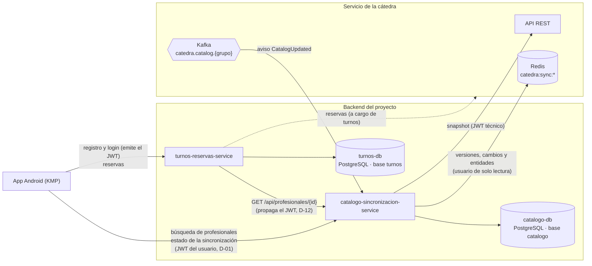
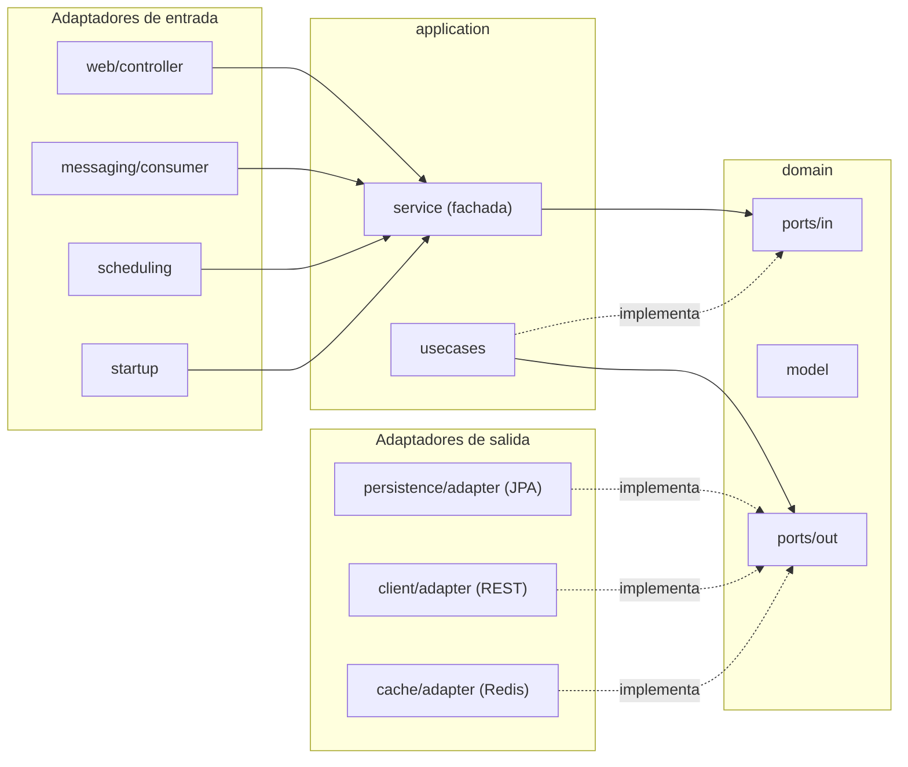

# Arquitectura

## Vista general

La solución tiene una app Android (KMP) y dos servicios backend con su propia base. Este servicio guarda la **copia local** del catálogo de la cátedra y la mantiene sincronizada; turnos nunca lee esa base, solo consulta la API ([contrato con turnos](contrato-turnos.md)).

| Integración | Dirección | Para qué |
| --- | --- | --- |
| App → catálogo | REST, JWT del usuario | Buscar profesionales (CU-04) e informar el estado de la copia (CU-06). La app consulta al catálogo directo, sin pasar por turnos (D-01). |
| Turnos → catálogo | REST, JWT del usuario propagado | Datos vigentes de un profesional y su agenda antes de una reserva (CU-05). |
| Catálogo → cátedra REST | `GET /api/synchronization/snapshot`, JWT técnico | Sincronización completa (CU-01) y recuperación (CU-03). |
| Catálogo → Redis de la cátedra | Lectura de `catedra:sync:*` | Versión publicada, cambios por versión y entidades (CU-02, D-07). |
| Kafka de la cátedra → catálogo | Topic `catedra.catalog.<grupo>` | Aviso `CatalogUpdated`: solo dispara la incremental; los datos salen siempre de Redis. |

El detalle de cada proceso está en [sincronizacion.md](sincronizacion.md), y el de la autenticación en [seguridad.md](seguridad.md).

## Capas hexagonales por feature

El código sigue la arquitectura hexagonal del repositorio de referencia de la cátedra: un paquete por feature (`ar.edu.um.programacion2.catalogo.<feature>`) y adentro `domain`, `application` e `infrastructure`.

- **`domain`**: el modelo (`domain/model`) y los puertos (`domain/ports/in` = casos de uso, `domain/ports/out` = lo que el dominio necesita de afuera). No importa Spring ni JPA.
- **`application`**: la implementación de cada caso de uso (`usecases/XxxUseCaseImpl`), el `Service` que hace de fachada y las excepciones de la aplicación. Depende solo de los puertos.
- **`infrastructure`**: los adaptadores que implementan los puertos `out` (JPA, REST, Redis) y los que llaman a la aplicación desde afuera (controllers, consumidor de Kafka, scheduler, listener de arranque). Cada adaptador traduce con su propio mapper escrito a mano.

| Feature | `domain` | `application` | `infrastructure` |
| --- | --- | --- | --- |
| `categoria` | `Categoria`, `CategoriaRepository` | — | `persistence` |
| `horario` | `HorarioSemanal`, `HorarioSemanalRepository` | — | `persistence` |
| `profesional` | `Profesional`, `AgendaProfesional`, `FiltroBusquedaProfesionales`, `Pagina`; `BuscarProfesionalesUseCase`, `ConsultarProfesionalUseCase`; `ProfesionalRepository` | `BuscarProfesionalesUseCaseImpl`, `ConsultarProfesionalUseCaseImpl`, `ProfesionalService`, `FiltroBusquedaInvalidoException`, `ProfesionalNoEncontradoException` | `persistence`, `web` |
| `sincronizacion` | `SnapshotCatalogo`, `CambiosVersion`, `VersionesPublicadas`, `VersionAplicada`, `IntentoSincronizacion`, `AvisoCatalogo`, `ResumenSincronizacion` y los enums de estado, proceso y resultado; 4 puertos `in` y 6 puertos `out` | `SincronizarCatalogoCompletoUseCaseImpl`, `SincronizarCatalogoIncrementalUseCaseImpl`, `VerificarVersionesPendientesUseCaseImpl`, `ConsultarEstadoSincronizacionUseCaseImpl`, `SincronizacionService` y las excepciones de la cátedra | `client` (REST), `cache` (Redis), `messaging` (Kafka), `persistence`, `scheduling`, `startup`, `web` |

`categoria` y `horario` no tienen casos de uso propios: su copia la escribe la sincronización y la leen los casos de uso de `profesional`, siempre a través de sus puertos `out`. La configuración técnica (clientes de la cátedra, propiedades, seguridad y JWT) está en el paquete `config`.

Los puertos `out` de la sincronización y sus adaptadores:

| Puerto (`domain/ports/out`) | Adaptador | Tecnología |
| --- | --- | --- |
| `CatalogoCatedraClient` | `HttpCatalogoCatedraClientAdapter` | `RestClient` contra la API REST de la cátedra |
| `CatalogoPublicadoClient` | `RedisCatalogoPublicadoClientAdapter` | `StringRedisTemplate` contra el Redis de la cátedra |
| `VersionAplicadaRepository`, `IntentoSincronizacionRepository`, `UltimaVerificacionRepository`, `AvisoCatalogoRepository` | `Jpa…RepositoryAdapter` | Spring Data JPA sobre PostgreSQL |
