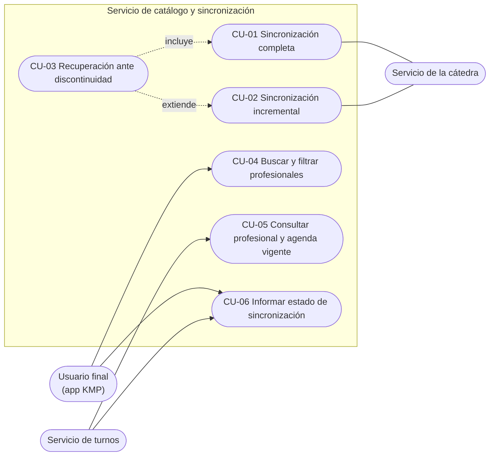

# Casos de uso — Servicio de catálogo y sincronización

Este documento describe **qué hace** el servicio desde el punto de vista de quienes lo usan. No define clases, tablas ni endpoints: eso se decide en el diseño de cada funcionalidad.

**Fuentes:** enunciado del proyecto (secciones 4.1, 5, 6 y 8) y contrato de integración con la cátedra (secciones 7, 14, 15.3, 16 y 18).

## Responsabilidad del servicio

El servicio mantiene la **copia local** del catálogo de la cátedra (categorías, profesionales y horarios semanales) junto con la **versión aplicada**. La mantiene actualizada con sincronización completa e incremental, y resuelve las búsquedas usando solamente esa copia local.

## Actores

| Actor | Tipo | Qué hace con el servicio |
| --- | --- | --- |
| **Usuario final** (desde la app KMP) | Principal | Busca y filtra profesionales. Consulta si el catálogo está al día. |
| **Servicio de turnos** | Principal | Pide los datos vigentes de un profesional y su agenda semanal antes de construir disponibilidad o iniciar una reserva. Consulta si el catálogo está al día. |
| **Servicio de la cátedra** | De apoyo | Entrega el snapshot completo (REST), los cambios incrementales (Redis) y los avisos de nueva versión (Kafka). |

Los procesos de sincronización no los inicia una persona: se disparan al arrancar el servicio, al recibir un aviso de nueva versión o al detectar que la copia local no se puede continuar.

## Diagrama

## Índice

| Caso | Resultado principal |
| --- | --- |
| [CU-01 Sincronización completa](CU-01-sincronizacion-completa.md) | La copia local queda reemplazada por el snapshot y la versión local es exactamente la del snapshot. |
| [CU-02 Sincronización incremental](CU-02-sincronizacion-incremental.md) | Los cambios pendientes se aplican en orden, sin repetir efectos, y la versión avanza. |
| [CU-03 Recuperación ante discontinuidad](CU-03-recuperacion-ante-discontinuidad.md) | Cuando no se puede continuar de forma segura, se reconstruye la copia con un snapshot. |
| [CU-04 Buscar y filtrar profesionales](CU-04-buscar-y-filtrar-profesionales.md) | El usuario obtiene profesionales filtrados por categoría, nombre, estado habilitado y disponibilidad. |
| [CU-05 Consultar profesional y agenda vigente](CU-05-consultar-profesional-y-agenda-vigente.md) | Turnos obtiene los datos vigentes que necesita antes de operar. |
| [CU-06 Informar estado de sincronización](CU-06-informar-estado-de-sincronizacion.md) | Se informa la versión aplicada, si está al día y el último error. |

## Decisiones del proyecto

| # | Decisión | Motivo |
| --- | --- | --- |
| D-01 | La app KMP consulta **directamente** al servicio de catálogo para buscar profesionales; no pasa por el servicio de turnos. | El catálogo es la única fuente local vigente para consultar profesionales (enunciado 4.1) y la búsqueda no debe depender de que turnos esté disponible (enunciado 8). |
| D-02 | La sincronización completa reemplaza la copia local **todo o nada**: mientras se aplica, las consultas ven la copia anterior completa. | El snapshot se debe aplicar de forma consistente y la versión solo se registra con las tres colecciones aplicadas (enunciado 6.1, contrato 7). |
| D-03 | Los reintentos ante fallas de la cátedra son **limitados**; agotados, se registra el error y se espera al próximo disparador. | El enunciado pide evitar ciclos de reintento ilimitados (enunciado 8). |
| D-04 | Sin una copia local completa, las búsquedas responden que el catálogo **no está disponible**, no una lista vacía. | Una lista vacía haría creer al usuario que no hay profesionales. |
| D-05 | La idempotencia de la sincronización incremental se resuelve **por versión**: un aviso o cambio de una versión ya incorporada no produce efectos nuevos. | Kafka entrega al menos una vez y puede duplicar o desordenar avisos (contrato 4, 15.1 y 18.1). |
| D-06 | Cada versión incremental se aplica **completa o no se aplica**: sus cambios y el avance de la versión se guardan juntos. | La versión local solo puede avanzar cuando su unidad de trabajo terminó correctamente (enunciado 6.2, contrato 14.5). |
| D-07 | Además de los avisos de Kafka, el servicio compara su versión con la publicada en Redis **al arrancar y periódicamente**. | Kafka es una notificación, no la fuente del catálogo; un aviso perdido debe detectarse comparando versiones (contrato 16). |
| D-08 | Ante una discontinuidad se hace **una sola reconstrucción por disparador**; si después vuelve a haber discontinuidad, se registra y se espera al próximo disparador. | Evita un ciclo infinito de snapshots y respeta los reintentos limitados (enunciado 8). |
| D-09 | El filtro de **disponibilidad** significa: profesional habilitado con al menos un horario semanal habilitado para el día de la semana de la fecha pedida. | El catálogo no conoce las ocupaciones; los turnos libres reales los calcula el servicio de turnos (enunciado 4.1 y 4.2). |
| D-10 | El estado de sincronización es uno de: **sin datos**, **al día**, **sincronizando** o **con error**. | El servicio debe informar el estado y los errores de sincronización (enunciado 4.1). |
| D-11 | El último error se informa con un motivo funcional, **sin datos sensibles**; el detalle técnico queda en los logs. | Evitar exponer secretos o detalles internos en respuestas (enunciado 9). |
| D-12 | Turnos **propaga el JWT del usuario** al consultar el catálogo, y el catálogo lo valida con el mismo secreto HS512 que usa turnos para emitirlo. | El catálogo igual tiene que validar el JWT del usuario porque la app KMP lo consulta directo (D-01); un JWT técnico propio entre servicios sería otra emisión de tokens sin beneficio. |
| D-13 | El estado se calcula con la **última sincronización registrada**: si está en curso es *sincronizando*; si terminó mal, *con error*, salvo que una verificación posterior haya encontrado la copia al día; si terminó bien (o no hay registro), *al día* o *sin datos* según haya versión aplicada. Una verificación sin versiones pendientes no registra un intento: solo actualiza la fecha de la última verificación. Al arrancar, una sincronización que quedó abierta se cierra como error. | El registro se persiste para que el último error sobreviva a un reinicio; una sincronización cortada por una caída no puede quedar *sincronizando* para siempre; y las verificaciones periódicas no llenan el registro de filas sin novedades. |
