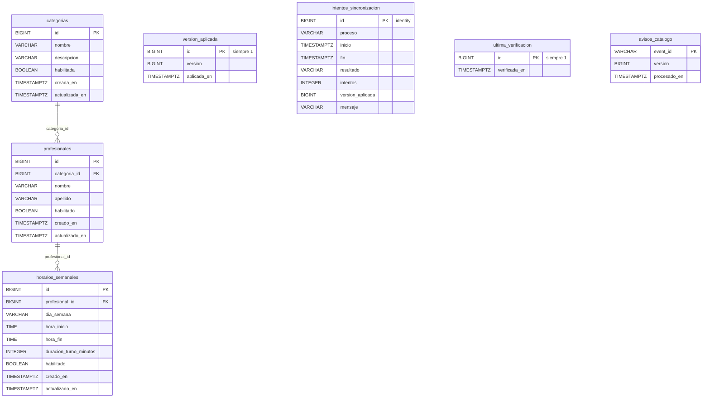

# Modelo de datos

## Propiedad de los datos

- **La cátedra es la fuente del catálogo.** Categorías, profesionales y horarios semanales se crean y se modifican en el servicio de la cátedra, que asigna sus identificadores.
- **Este servicio es dueño de su copia.** La base `catalogo` es exclusiva del servicio: solo él la lee y la escribe, y su esquema lo administran sus propias migraciones de Flyway (`src/main/resources/db/migration`).
- **Turnos no accede a esta base** ni guarda una réplica del catálogo: consulta lo vigente por la API ([contrato con turnos](contrato-turnos.md)).
- La copia solo cambia con la sincronización (completa, incremental o recuperación). Las búsquedas y consultas no la modifican.

## Diagrama

## Tablas

### Copia del catálogo (fuente: la cátedra)

| Migración | Tabla | Qué guarda |
| --- | --- | --- |
| V2 | `categorias` | Categorías profesionales. |
| V3 | `profesionales` | Profesionales; `categoria_id` referencia a `categorias` (`fk_profesionales_categoria`). |
| V4 | `horarios_semanales` | Franjas semanales de atención; `profesional_id` referencia a `profesionales` (`fk_horarios_semanales_profesional`). `dia_semana` guarda el día en inglés (`MONDAY` … `SUNDAY`), como lo envía la cátedra. |

En las tres tablas:

- El `id` es el que asigna la cátedra: no se genera acá. Por eso, cuando la incremental vuelve a guardar una entidad que ya existe, la pisa en lugar de duplicarla.
- Las bajas son **lógicas**: una entidad dada de baja queda con `habilitada` / `habilitado` en `false`, no se borra.
- `creada_en` / `actualizada_en` son las fechas que informa la cátedra.

### Estado de la sincronización (propio del servicio)

| Migración | Tabla | Qué guarda |
| --- | --- | --- |
| V5 | `version_aplicada` | La versión del catálogo aplicada en la copia local y cuándo se aplicó. Tiene **como máximo una fila**: el `CHECK (id = 1)` y la clave primaria impiden una segunda. Sin filas significa *sin datos*: nunca hubo una sincronización completa exitosa (D-04). |
| V6, V7 | `intentos_sincronizacion` | Una fila por sincronización. Se abre al empezar (`fin` y `resultado` en `NULL`) y se cierra con el resultado. `intentos` cuenta los pedidos hechos a la cátedra, reintentos incluidos. `mensaje` es un motivo funcional sin datos sensibles (D-11). |
| V8 | `ultima_verificacion` | Cuándo una verificación comprobó por última vez que no había versiones pendientes. Una sola fila (`id = 1`). Una verificación sin novedades pisa esta fila en lugar de registrar un intento (D-13). |
| V9 | `avisos_catalogo` | Avisos `CatalogUpdated` de Kafka ya procesados. `event_id` es la clave de idempotencia: un aviso repetido se reconoce aunque el servicio se haya reiniciado. |

Restricciones de `intentos_sincronizacion`:

- `ck_intentos_sincronizacion_proceso`: `proceso` es `COMPLETA`, `INCREMENTAL` o `RECUPERACION` (V7). Las filas anteriores a V7 se completaron con `COMPLETA` y después se sacó el `DEFAULT`, así cada fila nueva tiene que decir su proceso.
- `ck_intentos_sincronizacion_resultado`: `resultado` es `OK`, `CATEDRA_NO_DISPONIBLE`, `RECHAZO`, `DISCONTINUIDAD` o `ERROR` (V7 agregó `DISCONTINUIDAD`).
- `ck_intentos_sincronizacion_cierre`: `fin` y `resultado` son los dos `NULL` (en curso) o los dos no nulos (terminada).

### Otras

- **V1** no crea tablas: deja registrada la versión inicial en `flyway_schema_history`, la tabla con la que Flyway sabe qué migraciones ya corrieron.

## Reglas de las migraciones

- Se nombran `V<número>__<descripción>.sql` y se aplican en orden al arrancar.
- Una migración ya aplicada no se modifica: cada cambio va en un archivo nuevo (por ejemplo, V7 cambia restricciones de V6).
- Hibernate no crea tablas (`spring.jpa.hibernate.ddl-auto=validate`): solo verifica que las entidades coincidan con el esquema.
- Los tests corren las mismas migraciones sobre H2 en memoria ([pruebas.md](pruebas.md)).
