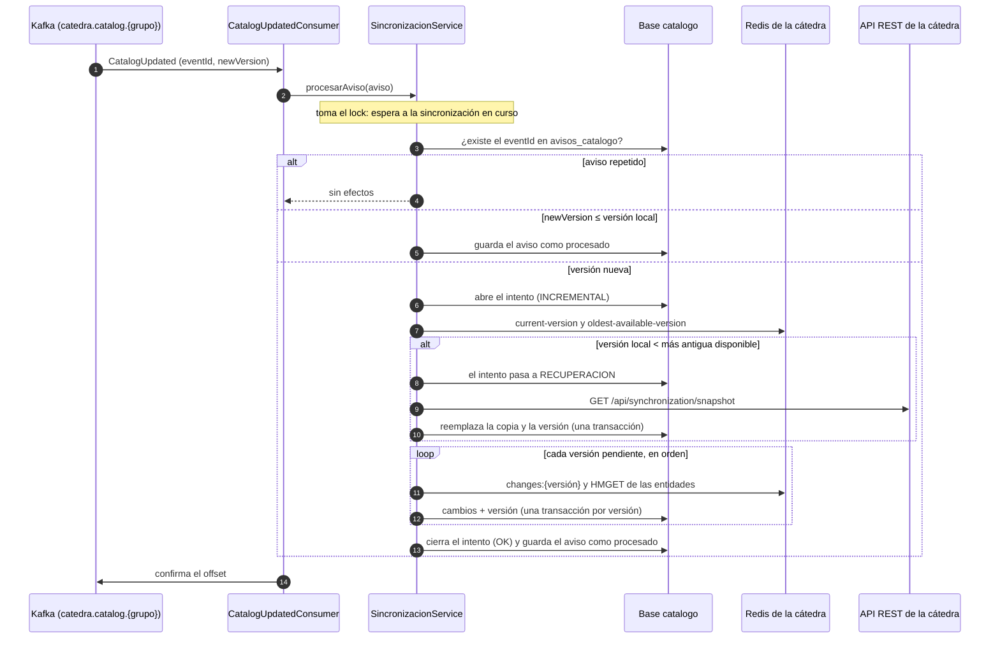

# Sincronización del catálogo

El servicio mantiene una copia local del catálogo de la cátedra. Hay tres procesos que la escriben, todos coordinados por `SincronizacionService`:

| Proceso | Caso de uso | Fuente | Cuándo |
| --- | --- | --- | --- |
| Completa | CU-01, `SincronizarCatalogoCompletoUseCaseImpl` | Snapshot por REST | Sin copia local. |
| Incremental | CU-02, `SincronizarCatalogoIncrementalUseCaseImpl` | Redis, versión por versión | Con copia local y versiones nuevas publicadas. |
| Recuperación | CU-03, dentro de `SincronizacionService` | Snapshot + incremental | La incremental encontró una discontinuidad. |

Kafka **solo avisa** que hay una versión nueva: los datos salen siempre de Redis o de un snapshot.

## Sincronización completa (CU-01)

1. Pide el snapshot: `GET /api/synchronization/snapshot` a la API REST de la cátedra, con el JWT técnico (`HttpCatalogoCatedraClientAdapter`).
2. En **una sola transacción** (`@Transactional`) borra horarios, profesionales y categorías (en ese orden, por las claves foráneas), inserta las tres colecciones del snapshot y guarda su versión en `version_aplicada`.

Es **todo o nada** (D-02): si algo falla, la transacción se deshace y queda la copia anterior con su versión. Mientras se aplica, las consultas siguen viendo la copia anterior completa.

## Sincronización incremental (CU-02)

1. Si no hay copia local, en lugar de la incremental hace la completa.
2. Lee de Redis `catedra:sync:current-version` y `catedra:sync:oldest-available-version` en un solo pedido.
3. Si la versión local es mayor o igual que la actual, no hay nada que aplicar (D-05).
4. Si la versión local es **menor que la más antigua disponible**, Redis ya no tiene los cambios intermedios: es una **discontinuidad** y pasa a la recuperación.
5. Aplica, **en orden**, cada versión desde la local + 1 hasta la actual. Para cada una:
   1. Lee `catedra:sync:changes:<versión>`: los ids de las categorías, profesionales y horarios que cambian. Si la clave no está, es una discontinuidad.
   2. Lee esas entidades de los Hash `catedra:sync:professional-categories`, `catedra:sync:professionals` y `catedra:sync:weekly-schedules` (`HMGET`). Si falta alguna, es una discontinuidad.
   3. **Recién con todo leído**, escribe en una transacción propia los cambios y la nueva versión (D-06). Cada entidad se guarda por el `id` de la cátedra: si ya existía, se pisa.

Cada versión se aplica completa o no se aplica. Si falla la versión N, las anteriores quedan aplicadas y la versión local queda en N − 1: la próxima incremental sigue desde ahí.

## Recuperación ante discontinuidad (CU-03)

Cuando la incremental lanza `DiscontinuidadException`:

1. El registro de la sincronización pasa a proceso `RECUPERACION` y guarda el motivo (por ejemplo, *"La versión local 3 es anterior a la más antigua disponible (5)"*).
2. Hace una sincronización completa con un snapshot.
3. Sigue con la incremental desde la versión del snapshot hasta la actual.

Se hace **una sola reconstrucción por disparador** (D-08): si después del snapshot vuelve a haber discontinuidad, la sincronización termina con resultado `DISCONTINUIDAD` y se espera al próximo disparador. Así no puede entrar en un ciclo de snapshots.

## Disparadores

| Disparador | Clase | Qué hace |
| --- | --- | --- |
| Arranque | `SincronizacionAlArrancarListener` (`ApplicationReadyEvent`) | Cierra como `ERROR` las sincronizaciones que quedaron abiertas por una caída y verifica: sin copia hace la completa; con copia, la incremental si hay versiones nuevas. Se apaga con `catedra.sincronizacion.al-arrancar=false`. |
| Aviso `CatalogUpdated` | `CatalogUpdatedConsumer` (`@KafkaListener`) | Procesa el aviso y **después** confirma el offset (`ack-mode=manual_immediate`). |
| Verificación periódica | `VerificacionPeriodicaScheduler` (`@Scheduled`) | Cada 5 minutos (`catedra.sincronizacion.intervalo-verificacion`), con la primera vuelta después de un intervalo, compara la versión local con `current-version` de Redis (D-07). Se apaga con `catedra.sincronizacion.verificacion-periodica=false`. |

Una verificación sin versiones pendientes **no registra un intento**: solo actualiza `ultima_verificacion`. Si no puede leer Redis para comparar, igual intenta la incremental, que reintenta y deja el error registrado.

**Una sola sincronización a la vez.** `SincronizacionService` usa un `ReentrantLock`: un aviso espera a que termine la sincronización en curso, y una verificación que encuentra otra en curso no hace nada, porque esa ya deja la copia verificada.

## Reintentos y clasificación de errores

Cada paso de una sincronización (el snapshot completo, o la incremental entera) se reintenta **solo si la cátedra no está disponible**, hasta `catedra.sincronizacion.max-intentos` (3) con una espera de `catedra.sincronizacion.espera-entre-intentos` (5 s) entre intentos (D-03). Agotados, se registra el error y se espera al próximo disparador.

| Excepción | Cuándo | ¿Reintenta? | Resultado registrado |
| --- | --- | --- | --- |
| `CatedraNoDisponibleException` | HTTP 5xx, timeout o sin conexión; respuesta sin cuerpo; Redis no responde o no publica las versiones. | Sí | `CATEDRA_NO_DISPONIBLE` |
| `CatedraRechazoException` | HTTP 4xx; Redis responde `WRONGPASS` o `NOPERM`. | No: reintentar no cambia nada. | `RECHAZO` |
| `DiscontinuidadException` | Faltan versiones, cambios o entidades en Redis. | Recupera una vez (D-08). | `DISCONTINUIDAD` si persiste |
| Otra `RuntimeException` | Error inesperado. | No | `ERROR` |

## Idempotencia y mensajes duplicados, perdidos o fuera de orden

Kafka entrega **al menos una vez** y puede repetir o desordenar los avisos (contrato 15.1). El servicio se protege en dos niveles:

- **Por versión (D-05):** solo se aplican versiones mayores que la local, y siempre en orden. Una versión ya incorporada no tiene efectos nuevos.
- **Por `eventId`:** cada aviso procesado se guarda en `avisos_catalogo`. Como está en la base, un aviso repetido se reconoce aunque el servicio se haya reiniciado.

| Situación | Qué pasa |
| --- | --- |
| **Aviso duplicado** (mismo `eventId`) | Se descarta sin tocar la copia. |
| **Aviso de una versión ya incorporada** (`newVersion` ≤ versión local), por ejemplo uno viejo que llega tarde | Se marca como procesado sin sincronizar. |
| **Aviso fuera de orden hacia adelante** (llega el de la versión 7 antes que el de la 6) | La incremental aplica **todas** las versiones pendientes en orden, desde la local + 1 hasta la actual de Redis. Cuando llega el aviso de la 6, ya está incorporada y no tiene efectos. |
| **Aviso perdido** | Lo recupera la verificación periódica (o la del próximo arranque): compara la versión local con la publicada en Redis y aplica lo que falte (D-07). |
| **Falla la incremental de un aviso** | El aviso **no** se marca como procesado y el error queda registrado. El offset se confirma igual; el atraso lo recupera la próxima verificación o un aviso posterior. |
| **Mensaje que no es JSON o que falla al procesarse** | Se registra en el log, se confirma el offset y el consumidor sigue con el siguiente: reintentar el mismo mensaje no ayuda. |
| **El mismo cambio se aplica dos veces** | Las entidades se guardan por el `id` de la cátedra, así que volver a aplicarlo no las duplica. |

## Estado de la sincronización

Cada sincronización queda registrada en `intentos_sincronizacion` (proceso, inicio, fin, resultado, cantidad de pedidos y motivo). `GET /api/sincronizacion/estado` ([api.md](api.md#estado-de-la-sincronización)) informa uno de cuatro estados (D-10), calculado por `ConsultarEstadoSincronizacionUseCaseImpl` (D-13):

1. Si la última sincronización registrada está **en curso** (sin `fin`): `SINCRONIZANDO`.
2. Si terminó **con un resultado distinto de `OK`**: `CON_ERROR`, salvo que haya una verificación posterior a su `fin` que encontró la copia al día.
3. Si no: `AL_DIA` si hay una versión aplicada, o `SIN_DATOS` si nunca se aplicó una copia completa.

Con error, la copia anterior se sigue usando para las búsquedas. El mensaje que se informa es un motivo funcional fijo (D-11): el detalle técnico queda en los logs.

Al arrancar, una sincronización que quedó abierta por una caída se cierra como `ERROR` (*"Interrumpida por un reinicio del servicio"*), para que el estado no quede `SINCRONIZANDO` para siempre.
